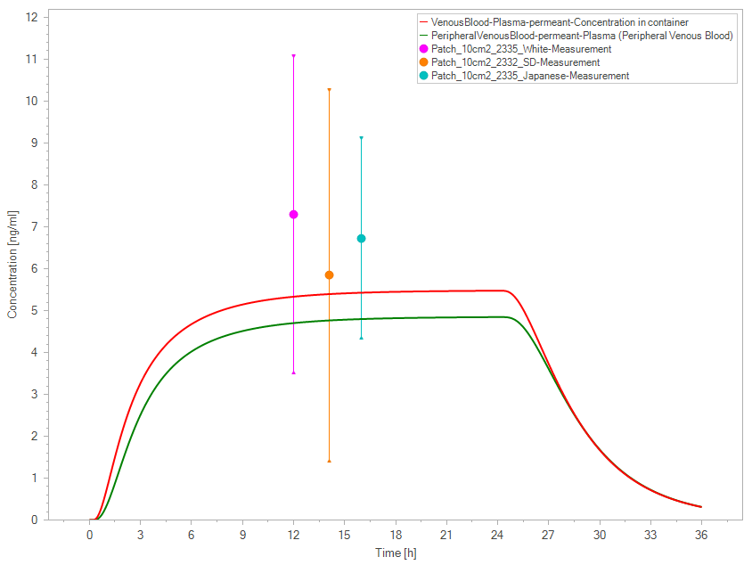
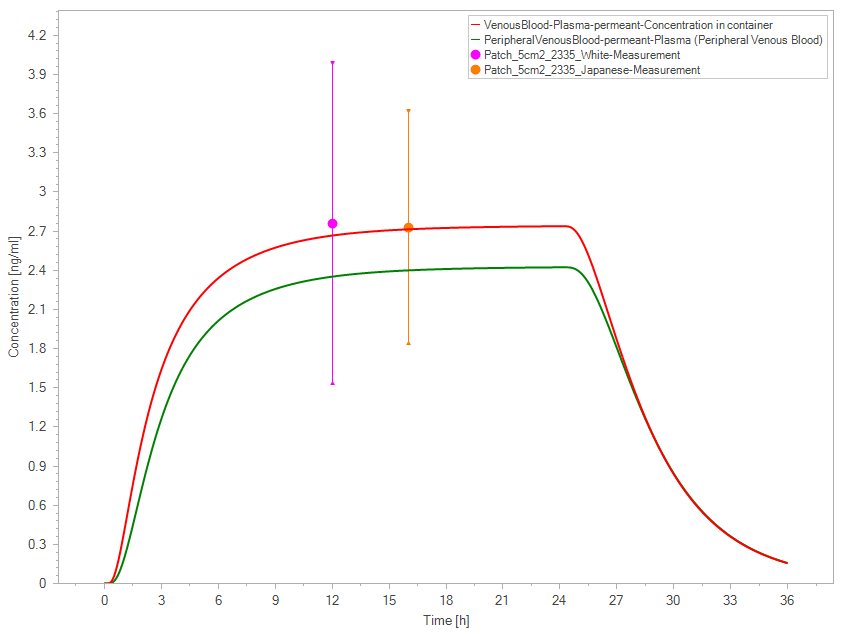
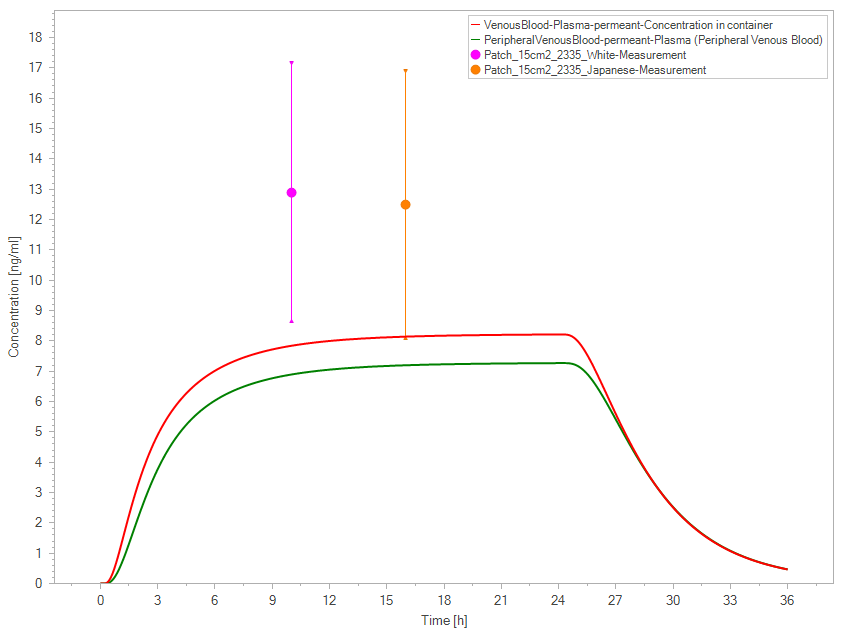
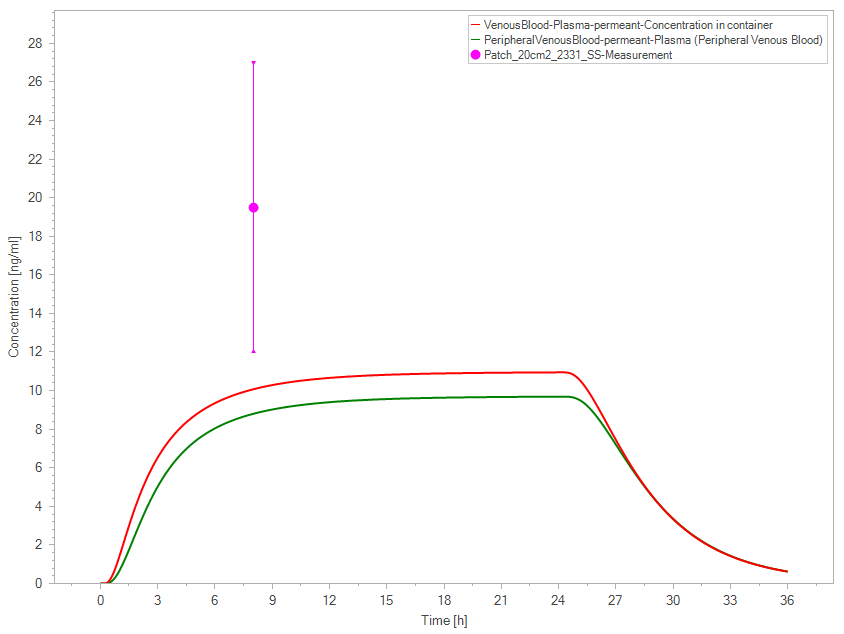

# Coupled Dermal-Permeation and Whole-Body PBPK Model of Rivastigmine Transdermal Patch in Humans (OSP Suite v12.3)

This open-source repository provides a coupled **mechanistic dermal permeation and middle-out whole-body physiologically based pharmacokinetic (PBPK)** model for the **rivastigmine transdermal delivery system** (approved 5 cm², 10 cm², and 15 cm² strengths, plus the unapproved 20 cm² investigational clinical trial arm), implemented in **Open Systems Pharmacology (OSP) Suite v12.3** (`PK-Sim® 12.3` and `MoBi® Version 12.3 - Build 136`).

The model links the multilayer diffusion-partition skin permeation framework of **Dancik et al. (2013)**—implemented in MoBi by **Hamadeh, Sevestre, & Edginton (2019)** (`Open-Systems-Pharmacology/Skin-permeation-model`)—to a calibrated middle-out whole-body human PBPK disposition model (with linear first-order systemic clearance) using the **Berezhkovskiy (2004)** tissue-partitioning method, lumped extrahepatic butyrylcholinesterase (BuChE) hydrolysis, and intravenous infusion data in healthy elderly subjects (**Morgan & Soh, 2017**).

---

## 1. Repository Structure and Dataset Dictionary

```text
Rivastigmine-Transdermal-PBPK/
├── README.md
├── LICENSE                                                # GNU General Public License v2.0 (GPL-2.0)
├── CITATION.cff                                           # Citation metadata
├── models/
│   ├── 01_Rivastigmine_Skin_MoBi.mbp3                     # Standalone multilayer skin & patch module (MoBi 12.3)
│   ├── 02_Rivastigmine_Body_PKSim.pksim5                  # Whole-body IV & oral PBPK model (PK-Sim 12.3)
│   ├── 03_Rivastigmine_Full_PBPK.mbp3                     # Coupled dermal-whole-body PBPK model (MoBi 12.3)
│   └── Sim_IV_1mg_30min.pkml                              # Exported systemic PBPK module for MoBi coupling
├── data/
│   ├── 00_patch_strengths_label.csv                       # Patch areas, loads, and labeled 24-h delivery rates
│   ├── 01_target_10cm2_24h_label_nominal.csv              # 24-h dermal calibration target (9.5 mg = 37.95 µmol)
│   ├── 02_target_10cm2_24h_residual_measured.csv          # Study 159 residual-patch apparent release reference
│   ├── 03_clinical_2331_AD_steadystate_Lefevre2008b.csv   # Study 2331 multiple-dose steady-state PK in AD patients
│   ├── 04_clinical_2332_elderly_singledose_Lefevre2008a.csv # Study 2332 single-dose 10 cm² PK in healthy elderly
│   └── 05_clinical_2335_healthy_singledose_Lefevre2009.csv  # Study 2335 single-dose 5-15 cm² PK in White & Japanese
└── results/
    ├── Fig_Patch_5cm2_SingleDose.png                      # 5 cm² (4.6 mg/24 h) single-dose profile vs. Study 2335
    ├── Fig_Patch_10cm2_SingleDose.png                     # 10 cm² (9.5 mg/24 h) single-dose profile vs. Studies 2332 & 2335
    ├── Fig_Patch_15cm2_SingleDose.png                     # 15 cm² (13.3 mg/24 h) single-dose profile vs. Study 2335
    ├── Fig_Patch_20cm2_vs_SS.png                          # 20 cm² (17.4 mg/24 h) single-dose baseline vs. Study 2331 SS
    └── Sim_Patch_10cm2_Data.xlsx                          # Full 0-36 h simulation output for 10 cm² (5-s step)
```

### Curated CSV Column Dictionary
Only tabulated summary statistics from peer-reviewed articles and FDA reviews were compiled into `data/`; published mean concentration-time curves were not digitized, so time-point-level profile residuals were not evaluated (Section 6.5):
* `01_target_10cm2_24h_label_nominal.csv` and `02_target_10cm2_24h_residual_measured.csv`: `Time [h]`, `Amount [umol]` (rivastigmine free base, MW = 250.34 g/mol), optional `SD [umol]` (reported in FDA NDA 022-083 Study 159), `Dataset`, `Target_type`, and `Source`.
* `03_...`, `04_...`, and `05_...`: `Time [h]` (plotted at published median or mean t_max as visual summary markers for C_max ± SD), `Concentration [ng/mL]`, `SD [ng/mL]`, `Study`, `Population`, `Dose_regimen`, `Regimen_type`, `Patch_cm2`, `Nominal_mg_24h`, `PK_metric_note`, and `Source`.

---

## 2. Model Architecture and Parameterization

Across all PK-Sim and MoBi modules, rivastigmine free base is represented under the molecule identifier `permeant`.

### 2.1. Systemic Compound Properties and Distribution Method Selection (`02_Rivastigmine_Body_PKSim.pksim5`)
| Parameter | Value | Unit | Provenance / Notes |
| :--- | :---: | :---: | :--- |
| Chemical formula / Molecular weight (`MW`) | C₁₄H₂₂N₂O₂ / 250.34 | g/mol | Rivastigmine free base (liquid at ambient temperature) |
| Ionization (`Compound type` / `pKa`) | Single basic pKa / 8.85 | — | EMA Prometax / Exelon EPAR Scientific Discussion |
| Neutral lipophilicity (`Lipophilicity`, log P) | 2.49 | Log Units | Henderson-Hasselbalch from D_7.0 = 4.27 at 37 °C (FDA Patch Label §11) and pKa = 8.85¹ |
| Fraction unbound in human plasma (`f_u`) | 0.60 (Albumin) | — | Plasma protein binding ~40% (FDA Label §12.3; EU SmPC §5.2) |
| Intrinsic neutral solubility (`Solubility`, `Ref-pH = 11.0`) | 2.04 | mg/mL | ALOGPS predicted neutral free-base water solubility (DrugBank DB00989 / HMDB0015124) |
| Specific intestinal permeability (`NDA_020823_Fa_99pct`) | 7.80 × 10⁻⁶ | cm/min | Modeler-calibrated building block yielding F_a = 0.99² |
| Partition coefficients / Cellular permeabilities | `Berezhkovskiy` / `PK-Sim Standard` | — | Selected via comparison against 1.0 mg IV infusion data (table below) |

¹ *FDA Exelon® Patch Prescribing Information (NDA 022-083, §11 Description) reports n-octanol/pH 7.0 phosphate buffer D_7.0 = 4.27 at 37 °C, giving log P = log10(4.27 × [1 + 10^(8.85 - 7.00)]) = 2.49, matching `log_K_ow = 2.49` in the dermal module. The earlier FDA Exelon® Capsules label (NDA 020-823, §11) reports 3.0 at pH 7.*  
² *Calibrated to human oral [¹⁴C]-rivastigmine mass-balance data (n = 6), where 120-h radioactivity recovery was 97% in urine and 0.4% in feces (FDA NDA 020-823 Label, §12.3 Elimination; EU SmPC §5.2 reports >90% in urine within 24 h and <1% in feces).*

**Comparison of PK-Sim Tissue Partitioning Methods (Fixed log P = 2.49, pKa = 8.85, f_u = 0.60):**  
Built-in QSAR methods were compared against 1.0 mg IV infusion data (**Morgan & Soh, 2017**, n = 8: V_z = 2.19 L/kg [EU SmPC V_d = 1.8–2.7 L/kg], C_max = 8.5 ng/mL, t_1/2 = 1.3 h; experimental human B:P = 0.9, FDA NDA 020-823 §12.3). Note that PK-Sim calculates global `Blood/Plasma concentration ratio` (1.78) via a separate internal erythrocyte equation across all four methods (Section 6.4), whereas tissue K_p formulations differ in how they treat neutral storage lipids and acidic phospholipids:

| PK-Sim Partition Coefficient Method | PK-Sim B:P (`K_rbc`) | V_ss,plasma (L/kg) | Full 0–24 h V_d (L/kg) | IV C_max (ng/mL) | Deep 15–24 h t_1/2 (h) | Key Internal Parameterization in PK-Sim |
| :--- | :---: | :---: | :---: | :---: | :---: | :--- |
| `PK-Sim Standard` (Willmann et al.) | 1.78 (2.66) | 22.1 | 46.5 | 3.47 | 25.0 | Uses log P = 2.49 directly as lipid/membrane affinity without plasma-ionization scaling in neutral triglycerides |
| `Rodgers and Rowland` (2005) | 1.78 (2.66) | 8.62 | 10.1 | 2.94 | 6.28 | Derives `Ka (acidic phospholipids) = 4.17` from predicted `K_rbc = 2.66` and applies it across tissues |
| `Schmitt` (2008) | 1.78 (6.47) | 6.21 | 6.66 | 2.76 | 4.15 | Computes `K (acidic phospholipids/water) = 6046` for protonated base partitioning |
| **`Berezhkovskiy` (2004) — Selected** | **1.78** (2.66) | **2.89** | **6.30** | **6.05** | **3.78** *(0.5–6 h: **1.40**)* | Computes pH-corrected `log D (veg.oil/water) = -0.04` without an acidic phospholipid term; most consistent with IV V_d and C_max |

### 2.2. Multilayer Skin and Patch Module (`01_Rivastigmine_Skin_MoBi.mbp3`)
* **Upstream model and v12.3 migration:** Adapted from `skin_permeation_model.mbp3` (**Dancik et al., 2013**; **Hamadeh et al., 2019**, `Open-Systems-Pharmacology/Skin-permeation-model`, internal structure `tdd_skin_v0`), migrated from MoBi 7.4 to `MoBi® Version 12.3 - Build 136`.
* **Patch geometry and dose scaling:** Constant areal load of 18,000 mg/m² (1.8 mg/cm²) and a **modeler-assumed** 100 µm (0.01 cm) adhesive matrix thickness:
  * **5 cm²:** 9.0 mg load (35.95 µmol), `Vehicle volume` = 0.05 mL (approved: labeled 4.6 mg/24 h)
  * **10 cm²:** 18.0 mg load (71.90 µmol), `Vehicle volume` = 0.10 mL (approved: labeled 9.5 mg/24 h)
  * **15 cm²:** 27.0 mg load (107.85 µmol), `Vehicle volume` = 0.15 mL (approved: labeled 13.3 mg/24 h; FDA sNDA 022-083/S-016, Ref ID 3171226)
  * **20 cm²:** 36.0 mg load (143.80 µmol), `Vehicle volume` = 0.20 mL (**unapproved investigational clinical trial arm**: 17.4 mg/24 h)
* **Complete dermal parameterization (`params_rivastigmine_patch_10cm2` and skin sublayers):**

| Container / Parameter Identifier | Value | Unit | Role / Provenance |
| :--- | :---: | :---: | :--- |
| `C / H / N / O atoms`; `Rings`; `Double bonds` | 14 / 22 / 2 / 2; 1; 4 | — | Schroeder molar volume = 301.00 mL/mol (`F, Cl, Br, I, S, Triple = 0`, `Grain class = 1.00`) |
| `log_K_ow` | 2.49 | — | Neutral log K_ow from D_7.0 = 4.27 (37 °C) and pKa = 8.85 |
| `Compound type` (`Use strongest acid/base pKa`) | 0 (0) | — | Global unionized switch across `vehicle`, `SC`, `ED`, and `DE` (Section 6.3) |
| `Experimental permeant water solubility` (`S_w`) | 8.60 × 10⁻³ | g/cm³ | Effective model saturation parameter (`Use experimental... = 1.00`, 30 °C; sensitivity in Section 6.2) |
| `Solubility S_v` | 8.60 × 10⁻³ | g/cm³ | Effective matrix saturation capacity (0.86 mg in 0.10 mL for 10 cm²; Section 6.2) |
| `Hydrated SC` / `Occluded vehicle` / `Volatile vehicle` | 1.00 / 1.00 / 0 | — | Occluded non-volatile patch (`In vivo = 1.00`, `Skin temperature = 30.00 °C`) |
| `Vehicle type` | 1.00 | — | Active-vehicle switch (>0; Dancik code 1 = water affects volatile deposition zone only when `Volatile vehicle = 1`, reset to 0 at 24 h removal) |
| `Boiling temperature` / `Melting temperature` / `Density` (as entered) | 316.00 / 20.00 / 1.10 | °C / °C / g/cm³ | ACD/Labs predicted BP (316.2 ± 34 °C), liquid MP input (20 °C), and initial density input retained in frozen model files (1.10 g/cm³; ~6% above predicted 1.038 ± 0.06 g/cm³). Verified inactive: molar volume uses Schroeder increments (301.00 mL/mol), `air` = 0.00 µmol under occlusion, and peak SC concentration (≤ 0.075 g/cm³) is ~15-fold below liquid density; a control run at 1.04 g/cm³ reproduced 24-h delivery of 9.50 mg (37.95 µmol) |
| `Vapor pressure` / `Wind velocity` / `Vehicle pH` | 5.75 × 10⁻⁸ / 16.80 / 7.40 | mmHg / cm/s / — | Inactive upstream template placeholders under occlusion and `Compound type = 0` |
| `V_max` / `K_M` (`skin_compartment`) | 0 / 1.00 | µmol/L/min / µmol/L | Cutaneous metabolism disabled (*"no indications of dermal metabolism"*, FDA NDA 022-083; ~2% degradation over 72 h cited in **Mita [Nozaki] et al., 2016**) |
| `SC_skin_sublayer`: `SC_no_layers` | 40 | — | 40 finite-volume sublayers (`one_layer_thickness = 0.5725 µm = 572.5 nm`; `delta = 13.00 nm` is intercellular lipid bilayer thickness, `w_lip = 0.10`, `w_pro = 0.90`, `rho_pro = 1.37 g/cm³`) |
| `SC_skin_sublayer`: `SC_total_thickness_hyd` | 2.29 × 10⁻³ (22.9) | cm (µm) | **Calibrated in simulation** (`Parameter Values` seed: 2.00 × 10⁻³ cm; template: 4.30 × 10⁻³ cm fully hydrated, 1.30 × 10⁻³ cm partially hydrated) |
| `ED_skin_sublayer`: `ED_no_layers` / `ED_total_thickness` | 40 / 0.10 (100) | — / mm (µm) | Viable epidermis (step 2.50 µm; `D_ed = 2.77 × 10⁻⁷ cm²/s`, `ED_flow = 1.00`) |
| `DE_skin_sublayer`: `DE_no_layers` / `Dermis thickness` | 40 / 387.00 | — / µm | Dermis (`Skin thickness = 0.50 mm`; `Q = 2.20 × 10⁻³ s⁻¹`, `S = 100 cm⁻¹`, `D_de = 2.77 × 10⁻⁷ cm²/s`, `D_bound = 1.00 × 10⁻⁷ cm²/s`) |
| `Follicle`: `Fraction dose entering follicles` | 0 | — | Transfollicular shunt disabled (`Follicle clearance = 0 L/min`, `Volume = 0 L`) |

### 2.3. Whole-Body PBPK Model (`02_Rivastigmine_Body_PKSim.pksim5`)
* **Virtual individual (`Morgan2017_Elderly_75kg`):** `European (ICRP, 2002)` male set to the mean demographics in the *Results* text of **Morgan & Soh (2017, p. 512)**: age 64.5 years (64.5 ± 6.4 y), weight 74.9 kg (74.9 ± 9.7 kg), height 169 cm (1.69 ± 0.09 m), BMI 26.2 kg/m² (observed 26.1 ± 2.8 kg/m²), representing a mixed-sex cohort (4 males, 4 females).
* **Extrahepatic BuChE hydrolysis and renal clearance:** Rivastigmine undergoes rapid cholinesterase hydrolysis to NAP226-90 with minimal CYP450 involvement (FDA NDA 020-823 Label §12.3). Whereas the oral capsule label states *"No parent drug was detected in urine"* (NDA 020-823 §12.3), patch administration resulted in ~3% of the dose excreted unchanged in urine (FDA NDA 022-083 ClinPharm Review), with mean CL_R = 1.95–3.43 L/h across cohorts in **Study 2335** (**Lefèvre et al., 2009**, Table I; **2.3–4.0%** of 86.6 L/h systemic CL), supporting CL_R = 0 in the model. A lumped first-order enzyme building block (`BChE | Human | Healthy`; `Reference concentration = 1.00 µmol/L`) was assigned `Relative expression = 1.00` in `Plasma` and across all 11 `Intestinal mucosa` segments (Section 6.4).
* **Systemic clearance calibration (`Morgan2017_IV_CL_86_6Lh`):** Calibrated to the 1.0 mg, 30-min IV infusion (**Morgan & Soh, 2017**) via `Specific clearance = 0.832 min⁻¹` (exact input `0.8317 min⁻¹`), matching observed plasma clearance (86.6 L/h = 19.27 mL/min/kg).

### 2.4. Dermal-Systemic Coupling and 24-h Patch Removal (`03_Rivastigmine_Full_PBPK.mbp3`)
Dermal capillary clearance (`k_de_clearance` across the 40 `DE_skin_sublayer` compartments) transfers drug into `DERMAL_APPLICATION_AREA|PKSim_Link`, connected directly to `Organism|VenousBlood|Plasma` via `PKSim_Link_VenousBlood_Plasma` and `PKSim_Link_whole_body_pt` (bypassing generic `Organism|Skin` so dermal clearance is not duplicated; inherited IV `Dose = 0 mg`). At t = 24.0 h (`Time >= 1440 min`), `remove_patch_24h` sets `Vehicle type = 0`, `vehicle|permeant = 0`, and `surface_pool|permeant = 0`, halting matrix input while allowing washout of the cutaneous depot (`SC + ED + DE`). Simulations are evaluated in forearm peripheral venous plasma (`Organism|PeripheralVenousBlood|permeant|Plasma`), which maintains a plateau ratio of 0.89 relative to `Organism|VenousBlood|Plasma` (2.42, 4.85, 7.27, and 9.69 ng/mL vs. 2.74, 5.48, 8.21, and 10.95 ng/mL across 5–20 cm²).

---

## 3. Calibration Results

### 3.1. Dermal Mass Balance at 24 h (10 cm² Patch)
| Compartment | Amount (µmol) | Mass (mg) | Share of 18.00 mg Load |
| :--- | :---: | :---: | :---: |
| Cumulative systemic input 0–24 h (`in_vivo_sink`, *calibration target*) | 37.95 | **9.50** | 52.8% |
| Residual patch content removed at 24 h (`surface_pool` 25.30 + `vehicle` 3.44) | 28.74 | **7.20** | 40.0% |
| Cutaneous tissue depot at 24 h (`SC + ED + DE`, washes out post-removal) | 5.21 | **1.30** | 7.2% |
| Evaporative loss (`air`) | 0.00 | **0.00** | 0.0% |
| **Total Mass Balance** | **71.90** | **18.00** | **100.0%** |

In the coupled model (`Sim_Patch_10cm2_Full_PBPK`), `AUC_0-inf × CL` (`124.8 µg·h/L × 86.6 L/h`) equals **10.8 mg**, matching standalone 0–24 h delivery (9.50 mg) plus post-removal washout of the 24-h cutaneous depot (1.30 mg) = **10.8 mg**. Across 5, 10, 15, and 20 cm², 0–24 h dermal delivery scales to **4.75, 9.50, 14.25, and 19.00 mg** (ratios of **1.03, 1.00, 1.07, and 1.09** vs. labeled 4.6, 9.5, 13.3, and 17.4 mg/24 h).

### 3.2. Systemic Intravenous Calibration (1.00 mg 30-min IV Infusion)
In **Morgan & Soh (2017, p. 512)**, the bioanalytical lower limit of quantification (LLOQ) was **0.05 ng/mL**. In PK-Sim, the automatic terminal regression (15–24 h, at 0.025 down to 0.0045 ng/mL—2- to 11-fold below LLOQ) yields `t_1/2 = 3.78 h` and `V_d,plasma = 472 L (6.30 L/kg)` (ratios of **2.91** and **2.88** vs. observed `t_1/2 = 1.3 h` and `V_z = 163.8 L [2.19 L/kg]`). Evaluated over the quantifiable window above LLOQ (0.5–6 h, down to 0.40 ng/mL), the apparent half-life is **1.40 h** (ratio **1.08**) and the corresponding window-matched `V_z = CL / λ_z` is **175 L (2.34 L/kg)** (ratio **1.07** vs. observed `V_z`; EU SmPC `V_d`: 1.8–2.7 L/kg):

| PK Metric | Simulated (`Sim_IV_1mg_30min`) | Observed (**Morgan & Soh, 2017**, Table 1, n = 8) | Role / Ratio (Sim/Obs) |
| :--- | :---: | :---: | :---: |
| Plasma clearance, CL (L/h [mL/min/kg]) | **86.6 [19.27]** | **86.6 [19.27]** | *Calibration target* (1.00) |
| AUC_0-inf (ng·h/mL [µmol·min/L]) | **11.6 [2.77]** | **11.6 [2.77]** | *Calibration target* (1.00) |
| End-of-infusion t_max (h) | 0.50 | Not tabulated *(0.50 h infusion end)* | Protocol-defined |
| C_max (ng/mL) | **6.05** | **8.5** | Evaluation (**0.71**) |
| V_ss,plasma (L [L/kg]) | **217 [2.89]** | Not reported *(EU SmPC V_d: 1.8–2.7 L/kg)* | — |
| Terminal V_z (L [L/kg]) | **175 [2.34]** *(0.5–6 h >LLOQ)*; 472 [6.30] *(15–24 h <LLOQ)* | **163.8 [2.19]** | **1.07** *(full 0–24 h: **2.88**)* |
| Terminal t_1/2 (h) | **1.40** *(0.5–6 h >LLOQ)*; 3.78 *(15–24 h <LLOQ)* | **1.3** | **1.08** *(full 0–24 h: **2.91**)* |

---

## 4. Model Evaluation

### 4.1. Oral Solution Evaluation (`Sim_Oral_3mg` — 3.00 mg Single Dose)
| PK Metric | Simulated (`Sim_Oral_3mg`) | Clinical Reference | Source & Fold Error (Sim/Obs) |
| :--- | :---: | :---: | :--- |
| Oral fraction absorbed (F_a) | **99%** | **97%** *(120-h urinary ¹⁴C)* | FDA Label NDA 020-823 §12.3 (**1.02**) |
| Absolute oral bioavailability (F) | **32.7%** | **36% ± 13%** *(young adults)* | EU SmPC §5.2; FDA Label §12.3 (~36%; **0.91**) |
| t_max (h) | **1.00** | **1.0** | Study 2332, Lefèvre et al., 2008a (**1.00**) |
| Apparent t_1/2 (h) | **1.67** *(1–6 h >LLOQ)*; 3.96 *(15–24 h <LLOQ)* | **1.45 ± 0.43** | Study 2332, Lefèvre et al., 2008a (**1.15** over 1–6 h) |
| C_max (ng/mL) | **3.70** | **7.63** *(elderly, SD not reported)* | Study 2332, Lefèvre et al., 2008a; Kurz 2009 (**0.48** — *outside 2-fold*) |
| AUC_0-inf (ng·h/mL) | **11.4** | **~23** *(elderly, SD not reported)* | Kurz et al., 2009 (**0.49** — *outside 2-fold*) |

While simulated F (32.7%), t_max (1.00 h), and 1–6 h t_1/2 (1.67 h) agree with single-dose regulatory values, **both C_max (FE = 0.48) and AUC_0-inf (FE = 0.49) fall slightly below the 2-fold (0.50–2.00) range** relative to healthy elderly subjects in **Study 2332** (n = 48). Per **FDA NDA 020-823 Label (§12.3 Age)**, mean oral clearance after a 2.5 mg dose is 30% lower in elderly (≥60 y, n = 24; 7 L/min) than in younger subjects (n = 24; 10 L/min), which accounts for a 1.43-fold increase—only partially explaining the 2.03-fold AUC difference (~23 vs. 11.4 ng·h/mL). At regulatory F = 36%, an AUC of ~23 ng·h/mL after 3 mg corresponds to an apparent systemic CL of ~47 L/h (within observed clinical ranges of 28.8–109.7 L/h in Study 2335 and 21.6–82.8 L/h in **Hossain et al., 2002**), alongside possible partial first-pass esterase saturation during rapid oral absorption.

### 4.2. Single-Dose Transdermal Patch Evaluation (0–36 h, Patch Removal at 24 h)
Because `SC_total_thickness_hyd` and systemic CL were calibrated to 9.50 mg/24 h (10 cm²) and 86.6 L/h, the three 10 cm² AUC comparisons are partially conditioned by calibration, whereas **C_max, post-removal t_1/2, and cross-strength scaling to 5 cm² and 15 cm²** (14 comparisons) are unconditioned.

Simulated peripheral venous concentrations (`Sim_Patch_10cm2_Full_PBPK`) reach 90%, 95%, 98%, and 99% of peak at **~7.7, 10.1, 13.4, and 15.9 h**, forming a plateau across 10–24 h (4.85 ng/mL at 24.0 h removal; numerical maximum at 24.3 h). Clinical median/mean t_max values (10.0–16.0 h) fall within this plateau window. Post-removal log-linear regression over 28–36 h (`R² > 0.999`, `λ_z = 0.279 h⁻¹`) yields **t_1/2,z = 2.48 h** (26–32 h: 2.68 h), compared with 2.25–3.02 h in Studies 2332/2335, **~3 h** in the US FDA Patch label (§12.3), and **3.4 h** in the EU SmPC (§5.2). Note that the virtual individual weighs **74.9 kg** (64.5 y), whereas **Study 2335** (**Lefèvre et al., 2009**, p. 433) enrolled lighter young males: **White** (24.9 ± 4.0 y, **71.1 ± 5.6 kg**) and **Japanese** (26.9 ± 3.2 y, **63.2 ± 6.2 kg**).

| Patch Size | Study & Cohort (**Single 24-h Application**) | PK Metric | Simulated (Periph. Venous) | Observed (Mean ± SD or Median) | Fold Error (Sim/Obs) |
| :---: | :--- | :---: | :---: | :---: | :---: |
| **5 cm²** (4.6 mg/24 h) | **Study 2335** — White (n = 20, 71.1 kg) | C_max (ng/mL) | **2.42** | 2.76 ± 1.23 | **0.88** |
| **5 cm²** | **Study 2335** — White (n = 20, 71.1 kg) | AUC_0-inf (ng·h/mL) | **62.4** | 52.4 ± 18.9 | **1.19** |
| **5 cm²** | **Study 2335** — White (n = 20, 71.1 kg) | t_1/2,post (h) | **2.48** | 2.89 ± 0.73 | **0.86** |
| **5 cm²** | **Study 2335** — White (n = 20, 71.1 kg) | t_max (h) | 10–24 plateau *(24.3)* | Median 12.0 | Plateau |
| **5 cm²** | **Study 2335** — Japanese (n = 19, 63.2 kg) | C_max (ng/mL) | **2.42** | 2.73 ± 0.89 | **0.89** |
| **5 cm²** | **Study 2335** — Japanese (n = 19, 63.2 kg) | AUC_0-inf (ng·h/mL) | **62.4** | 55.7 ± 18.1 | **1.12** |
| **5 cm²** | **Study 2335** — Japanese (n = 19, 63.2 kg) | t_max (h) | 10–24 plateau *(24.3)* | Median 16.0 | Plateau |
| **10 cm²** (9.5 mg/24 h) | **Study 2332** — Elderly (n = 48, Lefèvre 2008a) | C_max (ng/mL) | **4.85** | 5.84 ± 4.43 | **0.83** |
| **10 cm²** | **Study 2332** — Elderly (n = 48, Lefèvre 2008a) | AUC_0-inf (ng·h/mL) | **124.8** | 118 ± 92.4 | **1.06** |
| **10 cm²** | **Study 2332** — Elderly (n = 48, Lefèvre 2008a) | t_1/2,post (h) | **2.48** | 3.02 ± 0.83 | **0.82** |
| **10 cm²** | **Study 2332** — Elderly (n = 48, Lefèvre 2008a) | t_max (h) | 10–24 plateau *(24.3)* | Mean 14.1 | Plateau |
| **10 cm²** | **Study 2335** — White (n = 20, 71.1 kg) | C_max (ng/mL) | **4.85** | 7.29 ± 3.79 | **0.67** |
| **10 cm²** | **Study 2335** — White (n = 20, 71.1 kg) | AUC_0-24 (ng·h/mL) | **97.7** | 119 ± 58.3 | **0.82** |
| **10 cm²** | **Study 2335** — White (n = 20, 71.1 kg) | AUC_0-inf (ng·h/mL) | **124.8** | 137 ± 63.8 | **0.91** |
| **10 cm²** | **Study 2335** — White (n = 20, 71.1 kg) | t_1/2,post (h) | **2.48** | 2.25 ± 0.28 | **1.10** |
| **10 cm²** | **Study 2335** — White (n = 20, 71.1 kg) | t_max (h) | 10–24 plateau *(24.3)* | Median 12.0 | Plateau |
| **10 cm²** | **Study 2335** — Japanese (n = 19, 63.2 kg) | C_max (ng/mL) | **4.85** | 6.73 ± 2.40 | **0.72** |
| **10 cm²** | **Study 2335** — Japanese (n = 19, 63.2 kg) | t_max (h) | 10–24 plateau *(24.3)* | Median 16.0 | Plateau |
| **15 cm²** (13.3 mg/24 h) | **Study 2335** — White (n = 8, 71.1 kg) | C_max (ng/mL) | **7.27** | 12.90 ± 4.27 | **0.56** |
| **15 cm²** | **Study 2335** — White (n = 8, 71.1 kg) | AUC_0-inf (ng·h/mL) | **187.2** | 239 ± 81.1 | **0.78** |
| **15 cm²** | **Study 2335** — White (n = 8, 71.1 kg) | t_max (h) | 10–24 plateau *(24.3)* | Median 10.0 | Plateau |
| **15 cm²** | **Study 2335** — Japanese (n = 9, 63.2 kg) | C_max (ng/mL) | **7.27** | 12.50 ± 4.41 | **0.58** |
| **15 cm²** | **Study 2335** — Japanese (n = 9, 63.2 kg) | AUC_0-inf (ng·h/mL) | **187.2** | 256 ± 93.9 | **0.73** |
| **15 cm²** | **Study 2335** — Japanese (n = 9, 63.2 kg) | t_max (h) | 10–24 plateau *(24.3)* | Median 16.0 | Plateau |

*(Sources: Study 2332 — **Lefèvre et al., 2008a**, Table 1, p. 249 & FDA NDA 022-083 ClinPharm Review, p. 81; Study 2335 — **Lefèvre et al., 2009**, Table I, p. 434 & FDA sNDA 022-083/S-016 Review, Ref ID 3171226, p. 202.)*

**Summary Error Metrics:** Across the 17 single-dose transdermal comparisons, **GMFE = 1.26** and **AFE = 0.84** (range **0.56–1.19**; 17/17 within 2-fold, 14/17 within 1.5-fold). For the 14 unconditioned transdermal comparisons (excluding 10 cm² AUCs), **GMFE = 1.29** and **AFE = 0.82** (14/14 within 2-fold); by contrast, 2/4 oral elderly exposure comparisons in Section 4.1 fell just outside 2-fold (FE = 0.48–0.49).





### 4.3. Contextual Comparison Against Multiple-Dose Steady State in AD Patients (`Study 2331`)
Per **FDA NDA 022-083 Clinical Pharmacology Review**, rivastigmine transdermal PK at a fixed patch strength is **time-invariant** (10 cm² accumulation factor 1.02). In **Study 2331** (**Lefèvre et al., 2008b**, Table 2, p. 110, n = 51 AD patients), increasing patch area 4.0-fold from 5 to 20 cm² increased C_max 7.22-fold and AUC_0-24 7.45-fold, with apparent clearance (`Labeled Delivery / Observed AUC_0-24`) declining from **99.4 L/h** (5 cm²) to **74.8 L/h** (10 cm²), **57.1 L/h** (15 cm²), and **50.4 L/h** (20 cm²) due to **dose-dependent, capacity-limited elimination**. Both **Mita (Nozaki) et al. (2016)** and the present study couple a dermal diffusion model to lumped systemic elimination; whereas Mita et al. fitted a Michaelis-Menten K_m (24 ng/mL) to patch data to capture 15–20 cm² nonlinearity, we kept systemic clearance linear (anchored solely to 1.0 mg IV) so patch datasets remained external to systemic fitting:

| Patch Size | Single-Dose Sim C_max (ng/mL) | Study 2331 **SS** C_max (ng/mL) | C_max Ratio (Sim/Obs) | Linear Superposition AUC_0-24,SS (= AUC_0-inf,SD, ng·h/mL) | Study 2331 **SS** AUC_0-24 (ng·h/mL) | AUC Ratio (Linear SS / Obs SS) |
| :---: | :---: | :---: | :---: | :---: | :---: | :---: |
| **5 cm²** (4.6 mg/24 h) | 2.42 | 2.70 ± 1.20 | **0.90** | 62.4 *(SD AUC_0-24: 48.9)* | 46.3 ± 17.2 | **1.35** |
| **10 cm²** (9.5 mg/24 h) | 4.85 | 7.90 ± 2.90 | **0.61** | 124.8 *(SD AUC_0-24: 97.7)* | 127 ± 41.4 | **0.98** |
| **15 cm²** (13.3 mg/24 h) | 7.27 | 14.10 ± 6.30 | **0.52** | 187.2 *(SD AUC_0-24: 146.6)* | 233 ± 83.2 | **0.80** |
| **20 cm²** (17.4 mg/24 h, *unapproved*) | 9.69 | 19.50 ± 7.50 | **0.50** | 249.6 *(SD AUC_0-24: 195.4)* | 345 ± 127 | **0.72** |



---

## 5. Reproducibility Instructions (`OSP Suite v12.3`)

1. **Software:** Install [Open Systems Pharmacology Suite v12.3](https://github.com/Open-Systems-Pharmacology) (`PK-Sim® 12.3` and `MoBi® Version 12.3 - Build 136`).
2. **Standalone Dermal Module:** Open `models/01_Rivastigmine_Skin_MoBi.mbp3` in MoBi 12.3 and run `rivastigmine_patch_10cm2`.
3. **Whole-Body IV & Oral PBPK Model:** Open `models/02_Rivastigmine_Body_PKSim.pksim5` in PK-Sim 12.3 and run `Sim_IV_1mg_30min` and `Sim_Oral_3mg`.
4. **Coupled Transdermal PBPK Simulations:** Open `models/03_Rivastigmine_Full_PBPK.mbp3` in MoBi 12.3 and run `Sim_Patch_5cm2_Full_PBPK`, `Sim_Patch_10cm2_Full_PBPK`, `Sim_Patch_15cm2_Full_PBPK`, and `Sim_Patch_20cm2_Full_PBPK` (0–36 h, automatic patch removal at 24 h).

---

## 6. Model Assumptions and Limitations

1. **Linear first-order BuChE kinetics versus dose-dependent saturable elimination:** Rivastigmine covalently carbamylates the catalytic serine of acetylcholinesterase (AChE) and BuChE (**Bar-On et al., 2002**, <10% reactivation of *Torpedo* AChE over 48 h *in vitro*; human CSF AChE recovers over ~9–10 h, **Cutler et al., 1998**; **Polinsky, 1998**; EU SmPC §5.1). Human IV clearance declines from ~130 L/h at 0.2 mg to 86.6 L/h at 1.0 mg (**Morgan & Soh, 2017**) and ~70 L/h at 2.7 mg (EU SmPC §5.2; 21.6–82.8 L/h at 2.0 mg IV in AD patients, **Hossain et al., 2002**). Retaining linear clearance (86.6 L/h) causes systematic underprediction at higher patch strengths (15 cm² FE = 0.56–0.78; 20 cm² SS ratios = 0.50–0.72) and contributes to oral exposure underprediction in elderly subjects.
2. **Dermal solubility discrepancy (`8.60` vs. `2.04 mg/mL`) and `SC` thickness non-identifiability:** Whereas systemic `Solubility` uses predicted neutral free-base aqueous solubility (2.04 mg/mL), the dermal module retains `S_w = S_v = 8.60 × 10⁻³ g/cm³` paired with `SC_total_thickness_hyd = 22.9 µm` and an assumed 100 µm matrix thickness to represent effective thermodynamic activity of liquid rivastigmine free base (loaded at 180 mg/mL in the anhydrous polymer matrix). Direct sensitivity testing in `01_Rivastigmine_Skin_MoBi.mbp3` demonstrates strong parameter coupling: lowering `S_w` and `S_v` 4.22-fold to 2.04 mg/mL (at `SC = 22.9 µm`) reduces 24-h delivery from 9.50 mg (37.95 µmol) to **2.25 mg (9.00 µmol)** and would require an unphysiologically thin SC (~5.4 µm vs. 13–43 µm anatomical range) to recover 9.50 mg/24 h; conversely, setting `SC_total_thickness_hyd` to the fully hydrated template default of 43.0 µm (at `S_w = 8.60 mg/mL`) lowers 24-h delivery to **4.84 mg (19.35 µmol)** (cutaneous depot 1.99 mg) and would require `S_w ≈ 16.9 mg/mL` to match 9.50 mg/24 h.
3. **Global unionized skin switch (`Compound type = 0`):** Disabling ionization across all dermal layers avoids artificial aqueous protonation inside the anhydrous patch matrix (`Vehicle pH = 7.40`), but omits cation protonation (96.6% at pH 7.4) in viable epidermis and dermis.
4. **Lumped enzyme localization and unadjusted PK-Sim erythrocyte partitioning:** `BChE | Human | Healthy` uses an arbitrary reference concentration (1.00 µmol/L) and uniform relative expression (1.00) restricted to plasma and intestinal mucosa, omitting hepatic esterases and erythrocyte AChE binding/hydrolysis. In addition, PK-Sim's internal erythrocyte equation predicts `B:P = 1.78` (`K_rbc = 2.66`) rather than experimental human `B:P = 0.9` (FDA NDA 020-823 §12.3), and Berezhkovskiy overpredicts sub-LLOQ 15–24 h terminal `V_d` (`6.30` vs. `2.19 L/kg`).
5. **Absence of digitized concentration-time profiles, anatomical site effects, and single virtual anatomy:** Evaluation relied on tabulated summary metrics (C_max, AUC, t_max, t_1/2) without digitized time-series curves, inter-study release variability (8.47–8.97 mg in Study 159; ~8.1 mg in Study 2332), application-site differences (20–30% higher exposure on upper back/chest/upper arm vs. abdomen/thigh, **Lefèvre et al., 2007**), or population variability around the single 74.9 kg male virtual anatomy.

---

## 7. References

1. **Dancik Y, Miller MA, Jaworska J, Kasting GB.** Design and performance of a spreadsheet-based model for estimating bioavailability of chemicals from dermal exposure. *Adv Drug Deliv Rev.* 2013;65(2):221–236. `doi:10.1016/j.addr.2012.01.006`
2. **Hamadeh A, Sevestre M, Edginton A.** Implementation of Dancik et al (2013) skin permeation model in MoBi. *Open Systems Pharmacology GitHub Repository*; 2019. `https://github.com/Open-Systems-Pharmacology/Skin-permeation-model`
3. **Berezhkovskiy LM.** Volume of distribution at steady state for a linear pharmacokinetic system with peripheral elimination. *J Pharm Sci.* 2004;93(6):1628–1640. `doi:10.1002/jps.20073`
4. **Morgan TM, Soh B.** Absolute bioavailability and safety of a novel rivastigmine nasal spray in healthy elderly individuals. *Br J Clin Pharmacol.* 2017;83(3):510–516. `doi:10.1111/bcp.13133` (`PMID: 27639640`; `PMCID: PMC5306491`)
5. **Hossain M, Jhee SS, Shiovitz T, McDonald C, Sedek G, Pommier F, Cutler NR.** Estimation of the absolute bioavailability of rivastigmine in patients with mild to moderate dementia of the Alzheimer's type. *Clin Pharmacokinet.* 2002;41(3):225–234. `doi:10.2165/00003088-200241030-00006`
6. **Bar-On P, Millard CB, Harel M, Dvir H, Enz A, Sussman JL, Silman I.** Kinetic and structural studies on the interaction of cholinesterases with the anti-Alzheimer drug rivastigmine. *Biochemistry.* 2002;41(11):3555–3564. `doi:10.1021/bi020016x`
7. **Cutler NR, Polinsky RJ, Sramek JJ, Enz A, Jhee SS, Mancione L, Hourani J, Zolnouni P.** Dose-dependent CSF acetylcholinesterase inhibition by SDZ ENA 713 in Alzheimer's disease. *Acta Neurol Scand.* 1998;97(4):244–250. `doi:10.1111/j.1600-0404.1998.tb00645.x`
8. **Polinsky RJ.** Clinical pharmacology of rivastigmine: a new-generation acetylcholinesterase inhibitor for the treatment of Alzheimer's disease. *Clin Ther.* 1998;20(4):634–647. `doi:10.1016/s0149-2918(98)80127-6`
9. **Lefèvre G, Sedek G, Huang HLA, Saltzman M, Rosenberg M, Kiese B, Fordham P.** Pharmacokinetics of a rivastigmine transdermal patch formulation in healthy volunteers: relative effects of body site application. *J Clin Pharmacol.* 2007;47(4):471–478. `doi:10.1177/0091270006297748`
10. **Cummings J, Lefèvre G, Small G, Appel-Dingemanse S.** Pharmacokinetic rationale for the rivastigmine patch. *Neurology.* 2007;69(4 Suppl 1):S10–S13. `doi:10.1212/01.wnl.0000281846.40390.50`
11. **Lefèvre G, Pommier F, Sedek G, Allison M, Huang HL, Kiese B, Ho YY, Appel-Dingemanse S.** Pharmacokinetics and bioavailability of the novel rivastigmine transdermal patch versus rivastigmine oral solution in healthy elderly subjects (*Study 2332*). *J Clin Pharmacol.* 2008;48(2):246–252. `doi:10.1177/0091270007312154`
12. **Lefèvre G, Sedek G, Jhee SS, et al.** Pharmacokinetics and pharmacodynamics of the novel daily rivastigmine transdermal patch compared with twice-daily capsules in Alzheimer's disease patients (*Study 2331*). *Clin Pharmacol Ther.* 2008;83(1):106–114. `doi:10.1038/sj.clpt.6100242`
13. **Lefèvre G, Büche M, Sedek G, Maton S, Enz A, Lorch U, et al.** Similar rivastigmine pharmacokinetics and pharmacodynamics in Japanese and White healthy participants following the application of novel rivastigmine patch (*Study 2335*). *J Clin Pharmacol.* 2009;49(4):430–443. `doi:10.1177/0091270008330161`
14. **Kurz A, Farlow M, Lefèvre G.** Pharmacokinetics of a novel transdermal rivastigmine patch for the treatment of Alzheimer's disease: a review. *Int J Clin Pract.* 2009;63(5):799–805. `doi:10.1111/j.1742-1241.2009.02052.x`
15. **Mita S (indexed in PubMed as Nozaki S), Yamaguchi M, Lefèvre G.** Pharmacokinetic modeling to simulate the concentration-time profiles after dermal application of rivastigmine patch. *J Pharm Sci.* 2016;105(7):2213–2221. `doi:10.1016/j.xphs.2016.04.011` (`PMID: 27212635`)
16. **US Food and Drug Administration (FDA).** *Exelon® Patch (rivastigmine transdermal system) Prescribing Information (§11, §12.3) & Clinical Pharmacology and Biopharmaceutics Reviews (NDA 022-083, 2007; Supplemental NDA 022-083/S-016 Review, Reference ID: 3171226, Aug 31, 2012, p. 202)*; *Exelon® Capsules and Oral Solution Prescribing Information (NDA 020-823, §11, §12.3, 2000)*.
17. **European Medicines Agency (EMA) & Health Canada.** *Exelon / Prometax Summary of Product Characteristics (SmPC, §5.1, §5.2) & EPAR Scientific Discussion*; *Health Canada Exelon® Product Monograph*.

---

## 8. Author, License, and Disclaimer

* **Author:** Aleksandr Loginov (`biilsun81@gmail.com`)
* **License:** Released under the [GNU General Public License v2.0 (GPL-2.0)](LICENSE), consistent with the Open Systems Pharmacology Suite (`PK-Sim®` / `MoBi®`) and adapting the upstream dermal structure of **Hamadeh, Sevestre, & Edginton (2019)** (`Open-Systems-Pharmacology/Skin-permeation-model`).
* **Research-Only & Liability Disclaimer:** This PBPK model, associated parameterizations, and simulation outputs are provided **"AS IS"**, without warranty of any kind, express or implied, strictly for **scientific research and educational purposes**. The model represents a calibrated middle-out baseline with linear systemic clearance; it has not been qualified by any regulatory agency and **must not be used for medical advice, clinical decision-making, or patient dosing**. In no event shall the author be held liable for any claim, damages, or other liability arising from the use, interpretation, or modification of this repository.
